# Multi-Risk Supply Chain Intelligence System using Machine Learning & Explainable AI

Comprehensive Technical Report & Architecture Documentation

---

## 1. Executive Summary

Global supply chains operate in volatile environments where disruptions stem not only from internal operational bottlenecks, but also from multi-dimensional external shocks—including severe weather, geopolitical tensions, institutional and governance fragility, macroeconomic volatility (inflation and fuel price shocks), and natural catastrophe events.

Traditional supply chain risk systems typically rely on single-source operational records (e.g., historical enterprise shipping logs) to predict delivery delays or forecast demand. This project addresses this critical research and industrial gap by developing an **end-to-end Multi-Risk Supply Chain Intelligence System** that harmonizes internal transaction-level order data with **eight heterogeneous external datasets**.

The system provides:
1. **Multi-Source Data Fusion**: Rigorous geographical and temporal integration of 9 distinct data sources across 176,530 historical shipments.
2. **Leakage-Audited Feature Engineering**: Generation of 41 operational, geospatial, infrastructural, and macroeconomic features, audited against temporal and target leakage using customer-grouped cross-validation.
3. **Statistical Auditing & EDA**: Collinearity analysis (VIF), distribution analysis, and class balance verification.
4. **Benchmarked Machine Learning**: Trained and audited classification models (Logistic Regression, Random Forest, XGBoost) and delay duration regressors.
5. **Interactive Intelligence Dashboard**: A production-ready Streamlit web platform featuring 5 analytical views and a live order risk inference engine.

---

## 2. System Architecture & Data Lineage

```mermaid
flowchart TD
    subgraph Data_Sources [Heterogeneous Data Ingestion]
        D1[DataCo Smart Supply Chain<br/>176k Shipments]
        D2[Open-Meteo<br/>Weather & Precipitation]
        D3[World Bank LPI<br/>Logistics Performance Index]
        D4[World Bank WGI<br/>Worldwide Governance Indicators]
        D5[FAO Economic<br/>GDP & Manufacturing Strength]
        D6[FAO CPI<br/>Inflation Indices]
        D7[EM-DAT<br/>Disaster Database]
        D8[Global Fuel Prices<br/>Diesel Benchmarks]
        D9[Global Public Holidays<br/>Calendar Closures]
    end

    subgraph Preprocessing [Phase 1-3: Data Cleaning & Harmonization]
        P1[Standardize Country Aliases & ISO-3 Codes]
        P2[Temporal Alignment: Date / Month / Year]
        P3[Missing Value Imputation & Quality Validation]
    end

    subgraph Integration [Phase 4: Integration Engine]
        I1[Master Left Join on DataCo Operations]
        I2[Country + Date Weather & Holiday Merge]
        I3[Country + Year Macro, LPI, WGI, Disaster Merge]
        I4[Country + Year + Month Fuel Price Merge]
    end

    subgraph Features [Phase 5 & 6: Feature Engineering & Leakage Audit]
        F1[Operational Margins & Velocity]
        F2[Governance & Infrastructure Indices]
        F3[Environmental & Climate Factors]
        F4[GroupShuffleSplit Validation Protection]
    end

    subgraph ML_Engine [Phase 8 & 9: Machine Learning & Audits]
        M1[Risk Classifier: Random Forest & XGBoost]
        M2[Delay Duration Regressor]
        M3[Threshold Optimization & Probability Calibration]
    end

    subgraph Presentation [Phase 10: Streamlit Dashboard]
        UI1[Overview KPI Metrics]
        UI2[Geographic & Logistics Flow]
        UI3[Economic & Operational Health]
        UI4[External Risk Factors]
        UI5[Live Order Risk Prediction Engine]
    end

    Data_Sources --> Preprocessing
    Preprocessing --> Integration
    Integration --> Features
    Features --> ML_Engine
    ML_Engine --> Presentation
```



---

## 3. Data Ingestion & Harmonization (Phases 1–4)

### 3.1 Datasets Overview

| Dataset | Provider | Granularity | Key Metrics / Signals | Merge Key |
| :--- | :--- | :--- | :--- | :--- |
| **DataCo Smart Supply Chain** | Operational ERP | Transaction / Order Line | Shipping dates, real vs. scheduled days, order quantities, sales, profit | Master Anchor |
| **Open-Meteo Historical** | Open-Meteo API | Coordinates + Daily | Temperature, precipitation, snowfall, wind speed | `(Country, Date)` |
| **Logistics Performance Index (LPI)** | World Bank | Country + Year | Overall score, customs, infrastructure, international shipments, timeliness | `(Country, Year)` |
| **Worldwide Governance Indicators (WGI)** | World Bank | Country + Year | Political stability, rule of law, government effectiveness, regulatory quality, control of corruption | `(Country, Year)` |
| **FAO GDP / Macroeconomic** | UN Food & Agriculture Org | Country + Year | Gross Domestic Product, value-add from manufacturing | `(Country, Year)` |
| **FAO Consumer Price Index (CPI)** | UN Food & Agriculture Org | Country + Year | Inflation rates, baseline economic purchasing power | `(Country, Year)` |
| **EM-DAT Natural Disasters** | CRED EM-DAT | Country + Year | Disaster occurrence frequency, disaster classification, human/financial impact | `(Country, Year)` |
| **Global Fuel Price Database** | Global Petrol Prices | Country + Year + Month | Diesel fuel benchmark price ($/liter) | `(Country, Year, Month)` |
| **Global Public Holidays** | Nager.Date & Public APIs | Country + Date | National and regional public holidays, port/customs operating slowdowns | `(Country, Date)` |

### 3.2 Standardization & Entity Resolution
- **Country Standardization**: Built [`country_mapping.py`](file:///src/preprocessing/country_mapping.py) supporting over 200 sovereign nations and territories to map historical non-standard country strings (e.g., misspelled, local-language, or colloquial names) into unified ISO-3166-1 alpha-3 standards.
- **Handling Data Sparsity**: For indicators with multi-year release cadences (such as World Bank LPI reports every 2 years), forward-fill and regional median imputation were applied to prevent temporal bias.

---

## 4. Feature Engineering & Leakage Prevention (Phases 5–6)

### 4.1 Feature Taxonomy
The unified modeling dataset includes **41 engineered features** across four primary dimensions:

1. **Operational & Order Features**:
   - `order_item_total`, `sales_per_customer`, `order_item_profit_ratio`
   - `order_item_quantity`, `days_for_shipping_scheduled`
   - `shipping_mode` (Standard, First Class, Second Class, Same Day)
   - `customer_segment` (Consumer, Corporate, Home Office)
   - `market` and `order_region`
2. **Logistics & Infrastructure Features**:
   - `lpi_overall`, `lpi_customs`, `lpi_infrastructure`, `lpi_international_shipments`, `lpi_timeliness`, `lpi_tracking_tracing`
3. **Institutional & Governance Features**:
   - `wgi_political_stability`, `wgi_government_effectiveness`, `wgi_regulatory_quality`, `wgi_rule_of_law`, `wgi_control_corruption`, `wgi_voice_accountability`
4. **Macroeconomic, Climate & External Event Features**:
   - `gdp_val`, `cpi_val`
   - `fuel_price`
   - `weather_temperature`, `weather_precipitation`, `weather_wind_speed`
   - `disaster_count`, `is_holiday`

### 4.2 Leakage Audit & Validation Design
To eliminate target and temporal leakage:
- **Group Separation**: Evaluated using `GroupShuffleSplit` and `StratifiedGroupKFold` grouped by `customer_id` and `order_id` to guarantee that multi-item orders and customer-level repeated histories never leak between training and validation/test folds.
- **Strict Post-Order Filtering**: Excluded any feature recorded after shipment departure (e.g., actual delivery date, delivery status text, carrier exception notes) from the prediction feature vector.

---

## 5. Exploratory Data Analysis & Statistical Audits (Phase 7)

A complete statistical audit of the integrated dataset (176,530 rows × 42 columns) established baseline stability:

- **Target Balance**: The target `late_delivery_risk` is balanced across the historical dataset:
  - Class 0 (On Time / Early): 79,600 (45.1%)
  - Class 1 (Late Delivery Risk): 96,930 (54.9%)
- **Collinearity & VIF Analysis**:
  - High correlation within LPI sub-indicators (LPI infrastructure and overall index: $r = 0.989$) and WGI sub-indicators (rule of law and corruption control: $r = 0.977$).
  - Regularized linear baselines and tree-based ensembles handle this correlation without instability.
- **Missing Value Profile**: 0 missing values across the core operational and target features in the final modeling frame.

---

## 6. Machine Learning Models & Selection Audit (Phases 8–9)

### 6.1 Multi-Model Benchmarks

We trained and evaluated three classification paradigms:
1. **Logistic Regression (L2 Regularized Baseline)**
2. **Random Forest Classifier (Ensemble Bagging)**
3. **XGBoost Classifier (Gradient Boosted Trees)**

#### Decision Matrix Summary (Holdout Test Set)

| Evaluation Metric | Logistic Regression | Random Forest | XGBoost | Selected Model |
| :--- | :--- | :--- | :--- | :--- |
| **ROC-AUC** | 0.6384 | 0.7240 | **0.7276** | XGBoost / RF tied |
| **PR-AUC** | 0.7011 | 0.7949 | **0.7978** | XGBoost / RF tied |
| **Recall (Tuned @ 0.15 threshold)** | 0.8842 | 0.9984 | **0.9997** | XGBoost |
| **F1-Score** | 0.6512 | 0.7059 | **0.7061** | XGBoost |
| **Precision** | 0.5180 | **0.5459** | 0.5458 | Random Forest |
| **Brier Score (Calibration)** | 0.2241 | **0.1979** | 0.1983 | Random Forest |

### 6.2 Decision Matrix & Final Selection Rationale
- **Practical Equivalence**: The difference in ROC-AUC between Random Forest ($0.7240$) and XGBoost ($0.7276$) is under $0.0036$ ($< 0.5\%$), which is statistically and operationally negligible.
- **Calibration & Robustness**: Random Forest demonstrated slightly superior probability calibration (lower Brier score) and robust performance across repeated cross-validation folds.
- **Operational Thresholding**: For supply chain risk mitigation, false negatives (failing to identify an upcoming delay) carry substantial downstream stockout costs. Tuned decision thresholds allow prioritizing near-100% recall for mission-critical shipments.

### 6.3 Delay Regressor
In addition to binary risk classification, `train_delay_regression.py` trains an `XGBRegressor` and `RandomForestRegressor` to estimate the **exact number of delay days**, enabling planners to schedule buffer inventory and dynamically recalculate promised delivery dates.

---

## 7. Streamlit Intelligence Dashboard (Phase 10)

The front-end is implemented in `app.py` with modular backend analytics in `src/dashboard/`:

1. **📊 Overview Tab**: Real-time KPI summary (total orders, overall late rate, total financial volume, average profit margin), late rate trends over time, and breakdown by customer segment and shipping mode.
2. **🌍 Geography & Logistics Tab**: Regional delay risk breakdown, World Bank LPI scatter analysis, shipping mode vs. destination heatmaps.
3. **💰 Economic & Operational Tab**: Product category profitability, sales volume vs. delay risk, and order size distributions.
4. **⚠️ External Risk Tab**: Multi-dimensional risk analysis linking WGI political stability scores, extreme precipitation events, and regional natural disasters to delivery failures.
5. **🤖 Predict Order Risk Tab**: An interactive decision-support calculator allowing supply chain operators to input shipment specifications (origin, destination, shipping mode, items, value, current weather conditions) to obtain real-time late probability, risk classification, and predicted delay duration.

---

## 8. Repository Structure

```
supply-chain-intelligence/
├── app.py                                   # Streamlit Application Entrypoint
├── config/
│   └── config.yaml                          # Configuration parameters
├── dashboard/
│   └── app.py                               # Initial prototype UI
├── data/
│   ├── external/                            # External raw data (Open-Meteo JSONs, etc.)
│   ├── processed/                           # Harmonized intermediate CSVs
│   └── processed.zip                        # Bundled preprocessed data archive
├── generate_mapping.py                      # Country mapping generation script
├── main.py                                  # Pipeline execution entrypoint
├── models/                                  # Trained model checkpoint directory
├── Project.txt                              # Original planning notes
├── PROJECT_DETAILS.md                       # Comprehensive project documentation (this file)
├── README.md                                # GitHub repository presentation README
├── requirements.txt                         # Python environment requirements
├── results.zip                              # Bundled evaluation plots & audit reports
├── src/
│   ├── dashboard/                           # Production Streamlit Dashboard Components
│   │   ├── __init__.py
│   │   ├── analytics.py                     # Tab rendering and data aggregation logic
│   │   ├── charts.py                        # Plotly visual chart builders
│   │   ├── data_loader.py                   # Caching data loaders
│   │   ├── prediction_service.py            # Model inference service
│   │   └── prediction_ui.py                 # Interactive form & risk gauge renderer
│   ├── eda/
│   │   └── phase7_eda.py                    # Exploratory data analysis & VIF auditing
│   ├── features/
│   │   └── feature_engineering.py           # Feature creation & preprocessing pipeline
│   ├── integration/
│   │   ├── audit_fuel_coverage.py           # Fuel data temporal coverage checker
│   │   └── integrate_datasets.py            # Multi-source geographical & temporal joiner
│   ├── ml/
│   │   ├── phase9_model_selection_audit.py  # Statistical model selection & audit script
│   │   ├── phase9_train_models.py           # Model training & threshold evaluation
│   │   ├── predict_supply_chain_risk.py     # Standalone CLI prediction utility
│   │   └── train_delay_regression.py        # Delay days duration regressor
│   ├── preprocessing/                       # Raw dataset cleaning modules
│   │   ├── clean_dataco.py
│   │   ├── clean_emdat.py
│   │   ├── clean_fao.py
│   │   ├── clean_fuel.py
│   │   ├── clean_holidays.py
│   │   ├── clean_lpi.py
│   │   ├── clean_open_meteo.py
│   │   ├── clean_wgi.py
│   │   ├── country_mapping.py
│   │   ├── dataset_audit.py
│   │   └── targeted_audit.py
│   └── validation/
│       └── phase8_leakage_audit.py          # Data leakage & split integrity verification
```

---

## 9. Setup & Execution Guide

### Prerequisites
- Python 3.10+
- Recommended: Dedicated virtual environment (`venv` or `conda`)

### Installation
```bash
git clone https://github.com/Atharv-ND/Supply-Chain-Risk-Management.git
cd Supply-Chain-Risk-Management
python -m venv venv
# On Windows:
.\venv\Scripts\activate
# On Linux/macOS:
source venv/bin/activate

pip install -r requirements.txt
```

### Unpacking Datasets & Results (Optional)
If working directly with the processed datasets or pre-computed results:
```bash
# Extract preprocessed data
python -c "import zipfile; zipfile.ZipFile('data/processed.zip').extractall('data/')"

# Extract evaluation plots and audit reports
python -c "import zipfile; zipfile.ZipFile('results.zip').extractall('.')"
```

### Running the Dashboard
Launch the interactive Streamlit intelligence system:
```bash
streamlit run app.py
```

### Running Training & Audits
```bash
# Run multi-source data integration
python src/integration/integrate_datasets.py

# Run feature engineering
python src/features/feature_engineering.py

# Run statistical EDA & leakage audit
python src/eda/phase7_eda.py
python src/validation/phase8_leakage_audit.py

# Train models & perform selection audit
python src/ml/phase9_train_models.py
python src/ml/phase9_model_selection_audit.py
python src/ml/train_delay_regression.py
```

---

## 10. Summary of Key Findings & Business Impact

1. **Multi-Source Synergy**: Integrating geopolitical (WGI) and infrastructural (LPI) indicators significantly improves model robustness across international shipping routes compared to purely internal shipping records.
2. **Critical Operational Levers**: Shipping mode and customer destination market remain primary determinants of baseline risk, while weather shocks and regional infrastructure scores modulate acute risk.
3. **Actionable Decision Support**: Rather than presenting raw black-box outputs, the system exposes calibrated probabilities and interactive threshold tuning, enabling logistics managers to set proactive buffer inventory, adjust carrier SLAs, or reroute critical orders ahead of time.
